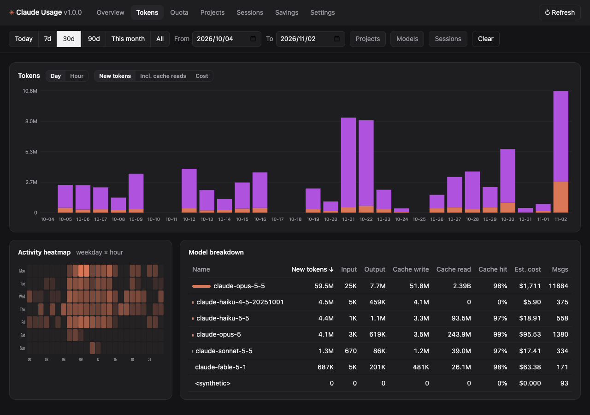
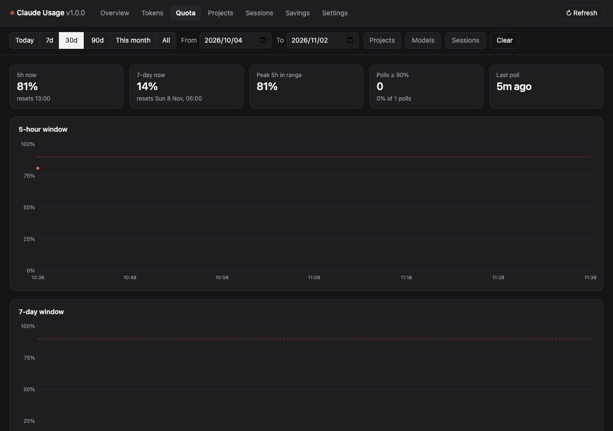

# claude-usage-swiftbar

Claude Code quota and token usage in your macOS menubar, with a local dashboard for the full history.



**Menubar:** 5-hour and 7-day quota (the same numbers as `/usage`), time to reset, today's tokens and estimated cost — pick which, in what order, in what style. Dropdown has progress bars, daily and hourly charts, and a per-model breakdown.

**Dashboard** (`Open dashboard`, served on `127.0.0.1:48123`): tokens per day/hour (input, output, cache write, cache read, cost), activity heatmap, quota utilization over time, project / session / model tables, optional savings from `rtk` / distill / context-mode, and a Settings tab. Filters: date presets or custom range, project, model, session — all in the URL so views are shareable with yourself.

Everything runs locally. The only network call is Anthropic's usage endpoint, using the Claude Code login already in your Keychain.

## Install

Requirements: macOS, [SwiftBar](https://swiftbar.app) (`brew install swiftbar`), `python3` (ships with Xcode CLT), Claude Code signed in. [Pillow](https://pypi.org/project/pillow/) is optional — with it, dropdown rows render as crisp white text; without, plain text.

```bash
curl -fsSL https://raw.githubusercontent.com/EillotBappo/claude-usage-swiftbar/main/install.sh | bash
```

Or clone and run `./install.sh`. It links `claude-usage.1m.sh` into your SwiftBar plugin folder, seeds `~/.config/claude-usage/settings.json`, and indexes `~/.claude/projects` once (a few seconds; later ticks only read appended bytes).

Update: `git -C ~/.claude-usage-swiftbar pull`. Remove: `~/.claude-usage-swiftbar/uninstall.sh [--purge]`.

## How it works

| Piece | Source |
|---|---|
| Quota % and reset times | `GET https://api.anthropic.com/api/oauth/usage` with the OAuth token from Keychain item `Claude Code-credentials`. Polled at most every `data.poll_interval` seconds (default 300), 10-minute backoff on errors, last good reply cached. Every poll is logged, which is what the quota history graph plots. |
| Tokens, models, projects, sessions | `~/.claude/projects/**/*.jsonl` transcripts, indexed incrementally into `~/.cache/claude-usage/usage.db` (SQLite). Streamed duplicates are deduped by message + request id. |
| Cost | Per-model USD/MTok table (`lib/claude_usage/pricing.json`, prefix-matched on model id) — **an estimate**, editable in Settings → Pricing. Subscription users pay nothing per token; the number is what the same usage would cost on the API. |
| Savings tab | Appears only if `rtk`, `~/.claude/tools/distill.db` or `context_mode.db` exist. |

"New tokens" = input + output + cache write. Cache reads are shown separately because they dominate totals and are cheap.

## Settings

Edit in the dashboard (Settings tab) or in `~/.config/claude-usage/settings.json`. The menubar picks changes up on its next tick.

```jsonc
{
  "menubar": {
    "fields": ["five_pct", "five_left", "week_pct"],   // also: week_left, today_tokens, today_cost, week_tokens
    "style": "pill",                                    // pill | icon | text | compact
    "thresholds": {"warn": 75, "danger": 90},           // title turns amber / red
    "show_when": {"mode": "always", "apps": ["zed", "Claude"]},  // "apps": only while one of these runs
    "hide_below_pct": 0,                                // hide the item while both windows are under this
    "dropdown": {"charts": true, "days": 14}
  },
  "data": {
    "poll_interval": 300, "scan_days": 90,
    "roots": ["~/.claude/projects"], "include": [], "exclude": [],   // glob patterns on file paths
    "project_labels": {"/Users/me/code/app": "App"}     // cwd or folder name → label
  },
  "pricing": {"claude-opus-5-5": {"in": 5, "out": 25, "cache_w": 6.25, "cache_r": 0.5}},
  "dashboard": {"port": 48123, "idle_exit_min": 30, "default_range": "7d"}
}
```

Env overrides: `CLAUDE_USAGE_HOME` (config dir), `CLAUDE_USAGE_CACHE` (cache dir), `CLAUDE_USAGE_PYTHON` (interpreter).

## Dashboard



The server starts on demand from the menu and exits after `dashboard.idle_exit_min` minutes without requests. Run it in the foreground with `claude-usage.1m.sh serve`. JSON API under `/api/` (`summary`, `series?bucket=day|hour`, `heatmap`, `breakdown?by=model|project|session`, `quota`, `savings`, `options`, `settings`) — all accept `from`, `to`, `range`, `project`, `model`, `session`.

## Development

```bash
python3 -m pytest          # 41 tests, no network, temp dirs
PYTHONPATH=lib python3 -m claude_usage.menubar        # print what SwiftBar would show
PYTHONPATH=lib python3 -m claude_usage.server --serve --port 48999
```

## Privacy

Transcripts never leave your machine; the plugin reads them, writes aggregates to a local SQLite file, and shows them to you. The usage endpoint call carries only your existing OAuth token.

## License

MIT
